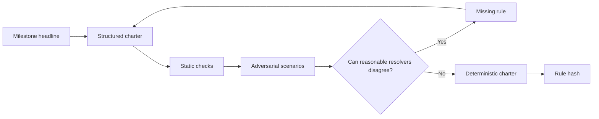

# milestone-spec

**Can two reasonable resolvers disagree on this market?**

Binary markets are only binary once their resolution rules are precise.

For example:

> Will Acme raise $5M before December 31?

Sounds objective.

But consider:

- a $5M SAFE is signed December 29
- funds arrive January 3

Should the market resolve **YES** or **NO**?

Both answers are reasonable unless the market defines what **“raise”** means.

`milestone-spec` catches ambiguous milestone-market resolution rules before people trade against them.

It:

- compiles milestone headlines into structured resolution charters
- runs deterministic static checks for missing rules
- generates concrete adversarial scenarios
- finds cases that produce conflicting `YES` / `NO` outcomes
- identifies the minimum missing rule causing the conflict
- computes a canonical Keccak-256 rule hash once the charter is deterministic

---

## 20-second example

```bash
milestone attack examples/fundraising/bad/simple_raise.yaml
```

Output:

```text
Market
──────
Will Acme raise $5M before December 31, 2027?

Result
──────
NOT DETERMINISTIC

Generated 11 adversarial scenarios.
11 allow conflicting resolutions.

Most important ambiguity
────────────────────────
What event counts as "raising" capital?

Counterexample
──────────────
$5000000 term sheet signed 2 days before deadline; funds wire 3 days after deadline.

Reasonable interpretation A:
Yes
  if completion_event = term_sheet_signed

Reasonable interpretation B:
No
  if completion_event = funds_received_in_bank

Minimal missing rule
────────────────────
fundraising.completion_event

Choose one:
- term_sheet_signed
- definitive_agreement_signed
- funds_received_in_bank
- legal_close_and_funds_received

10 more ambiguous scenarios hidden.
Use --all to display.
```

Once the missing rules are specified in the charter (for example [cash_received_primary_equity.yaml](examples/fundraising/resolved/cash_received_primary_equity.yaml)):

```yaml
completion_event: legal_close_and_funds_received
allowed_instruments:
  - priced_equity
include_secondary: false
deadline: 2027-12-31T23:59:59Z
```

Then:

```text
LISTABLE

Rule hash:
0x0dc46e74ddb8af344eefbcb42cbcd06567efe4f0c5c5e0c8dd94bed4ef80f075
```

---

## 30-second demo

Check any headline directly from the command line:

```bash
cargo run -p milestone-cli -- check \
  "Will Acme raise $5M before Dec 31, 2027?"
```

Expected output:

```text
Will Acme raise $5M before Dec 31, 2027?

NOT READY TO LIST

Why:
What event counts as "raising" capital?

Counterexample:
$5000000 term sheet signed 2 days before deadline; funds wire 3 days after deadline.

Yes if completion_event = term_sheet_signed
No if completion_event = funds_received_in_bank

Missing rule:
fundraising.completion_event

Candidate policies:
- term_sheet_signed
- definitive_agreement_signed
- funds_received_in_bank
- legal_close_and_funds_received
```

Then attack the full specification to inspect concrete counterexamples:

```bash
cargo run -p milestone-cli -- attack \
  examples/fundraising/bad/simple_raise.yaml
```

Or launch the interactive web demo:

```bash
cargo run -p milestone-cli -- serve
```

Open `http://127.0.0.1:8787` to step through the biggest resolution ambiguities one click at a time until the market becomes `READY TO LIST`.

---

## How it works



---

## Three example ambiguity classes

1. **Fundraising (`Will Acme raise $5M before Dec 31?`)** — Signing vs receipt of funds, equity vs venture debt, primary issuance vs founder secondary, convertible note conversion, conditional commitments, and midnight timezone boundaries.
2. **ARR (`Will Acme reach $1M ARR?`)** — Contracted recurring revenue vs annualized MRR, professional services and one-time fees, signed-not-started contracts, promotional discounts, churn notices, and post-deadline accounting restatements.
3. **Acquisition (`Will Acme be acquired for at least $100M?`)** — Public announcement vs legal close, enterprise value vs equity value, contingent earn-outs, private acquirer stock, partial stakes, and antitrust termination after announcement.

*(The engine also supports **Employment** and **Audience** milestones.)*

---

## CLI usage

```bash
# Check a natural-language headline in one command
milestone check "Will Acme raise $5M before Dec 31, 2027?"

# Lint a specification for resolution ambiguities (--verbose for full detail)
milestone lint examples/fundraising/bad/simple_raise.yaml

# Generate adversarial counterexamples (--all to show every scenario)
milestone attack examples/fundraising/bad/simple_raise.yaml

# Compute canonical Keccak-256 rule hash
milestone hash examples/fundraising/resolved/cash_received_primary_equity.yaml

# Deterministically resolve a specification against an evidence bundle
milestone resolve \
  examples/arr/resolved/contracted_arr_audited.yaml \
  examples/arr/evidence_sample.yaml

# Print a human-readable resolution charter
milestone explain examples/arr/resolved/contracted_arr_audited.yaml

# Start the local interactive demo
milestone serve
```

---

## Deterministic rule hashing

Once a charter has no missing rules, `milestone-spec` canonicalizes it (normalizing decimal precision, currency codes, UTC timestamps, and unordered rule sets, and sorting all JSON keys lexicographically) and hashes the canonical byte stream with **Keccak-256**.

Equivalent YAML and JSON charters with different formatting, key ordering, or trailing zeros always produce the exact same `ruleHash`.

---

## Why this isn't just an LLM prompt

The natural-language parser can help turn a headline into a draft charter—and deliberately leaves unstated rules as `null` rather than guessing.

Once the structured charter exists:

- **Linting is deterministic** across 14 static checks.
- **Resolution is deterministic**—the resolver never asks an LLM to choose `YES` or `NO`.
- **Arithmetic is exact** using fixed-point `Decimal` (`$999,999.99` vs `$1,000,000.00` vs `$1,000,000.01`).
- **Adversarial checks use explicit semantics** and counterexample minimization to pinpoint the smallest missing rule.
- **Boundary rules are strict** (`deadline - 1s`, `deadline`, `deadline + 1s`, FX source/timestamp matching, and `UNRESOLVED / SOURCE_CONFLICT` when authoritative sources disagree without a precedence rule).
- **Evidence ordering is invariant**—permuting the evidence bundle never changes the outcome.
- **Rule hashing is deterministic** via canonical Keccak-256.

---

## Implementation

The workspace separates parsing, linting, resolution, and adversarial testing into focused Rust crates:

- `crates/milestone-core` — Typed charter AST, evidence model, canonical byte encoder, Keccak-256 `rule_hash`
- `crates/milestone-parser` — Pattern-based draft headline parser (`PARSED_WITH_GAPS`)
- `crates/milestone-lint` — 14 static checks and `evaluate_listability` (`LISTABLE`, `LISTABLE_WITH_WARNINGS`, `NOT_LISTABLE`)
- `crates/milestone-resolver` — Deterministic `resolve(spec, evidence)` returning `YES`, `NO`, `INVALID`, or `UNRESOLVED`
- `crates/milestone-adversarial` — Adversarial scenario generator and counterexample minimizer
- `crates/milestone-cli` — `milestone` CLI and lightweight local web demo
- `examples/` — 25 `bad/` and `resolved/` YAML fixtures across all five milestone classes

---

## Testing

```bash
cargo fmt --all -- --check
cargo clippy --workspace --all-targets -- -D warnings
cargo test --workspace
```

The test suite verifies:
- `tests/properties/` (`proptest`) — repeated-call determinism, canonical Keccak-256 invariance, evidence permutation invariance, decimal threshold boundaries, second-level deadline boundaries, and FX policy enforcement
- `tests/adversarial/` — ambiguity detection and counterexample minimization across all 5 classes
- `tests/regression/` — exact numeric/temporal boundaries, source-conflict blocking, self-attestation control risk, and validation of all 25 example charters

---

## Development

Build and run checks locally:

```bash
cargo test --workspace
cargo run -p milestone-cli -- check "Will Acme reach $1M ARR by June 30, 2027?"
```
